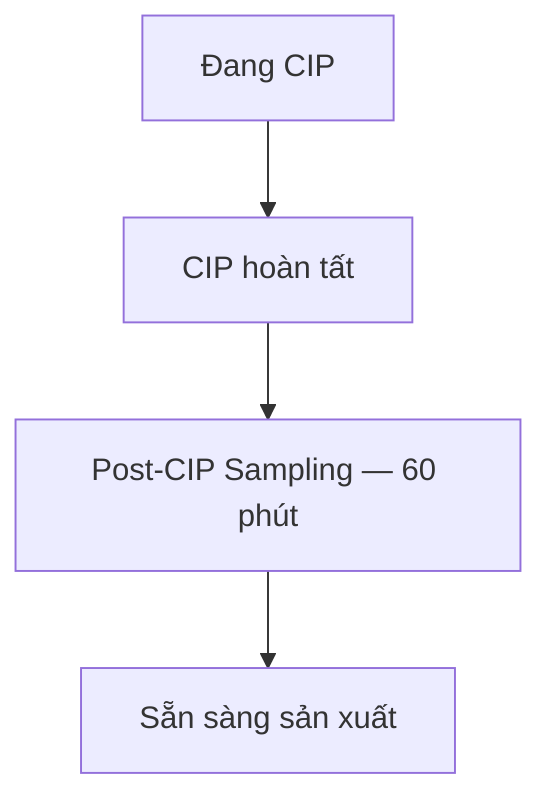

# PLAN PHÁT TRIỂN WEB APP CBTO SHOPFLOOR (MVP)

**Phiên bản:** Team Review — 26/10/2026  
**Trạng thái:** Kế hoạch và đặc tả MVP; chưa phải mã nguồn đã triển khai.  
**Nền tảng:** Responsive Web / PWA — React, Next.js, Firebase, Firestore, Firebase Hosting.

Tài liệu này thay thế toàn bộ kế hoạch Android Jetpack Compose trước đây. Phạm vi bên dưới là phạm vi team đã chốt. Chỉ kế thừa nghiệp vụ ghi nhận hiện trường, Loss, Runtime, CIP và lịch làm việc từ Power Apps; không chuyển nguyên bộ chức năng của app cũ hoặc kế hoạch cũ vào MVP.

## 1. Mục tiêu

Xây dựng một Web App nội bộ CBTO dành cho Công nhân vận hành, Tổ trưởng và Supervisor để:

- Chuẩn hóa ghi nhận dữ liệu vận hành hiện trường.
- Thay thế ghi chép giấy, Excel và trao đổi vận hành rời rạc qua Zalo.
- Hỗ trợ điều hành sản xuất theo thời gian thực khi có kết nối.
- Tạo nguồn dữ liệu FACT phục vụ phân tích Loss, CIP, Runtime và cải tiến.
- Không thay thế MES; không thay thế CMMS.

Bốn thông tin điều hành cốt lõi: **Sản lượng — Loss — Runtime — CIP**.

## 2. Phạm vi hệ thống

### 2.1. Phạm vi MVP

| Nhóm | Chức năng |
|---|---|
| Ghi nhận hiện trường | AM, ghi nhận bất thường, Loss Time, nhật ký vận hành, giao ca điện tử |
| Theo dõi vận hành | Runtime theo SKU, hạn CIP, tiến độ theo Line/SKU, lịch làm việc |
| Điều hành | Dashboard Supervisor, KPI vận hành |

Hệ thống có đúng 8 module nghiệp vụ tại mục 4–11. Dashboard và KPI tổng hợp dữ liệu từ các module này.

### 2.2. Không thuộc phạm vi MVP

Không phát triển:

- Work Order bảo trì; quản lý phụ tùng.
- RCA, CAPA, 5 Why; Predictive Maintenance.
- AI Camera; QR Code; chụp ảnh bắt buộc.
- Quản lý Batch; quản lý PO; truy xuất nguồn gốc.
- Chấm công; quản lý nghỉ phép.

Không đưa lại từ kế hoạch cũ: vòng đời Incident bảo trì nhiều bước, Action Tracking/CAPA riêng, MTBF/MTTR, chữ ký điện tử bắt buộc, dự báo hoàn thành mẻ/chuyển line, đồng hồ CIP cưỡng bức thứ hai, tích hợp AppSheet hoặc khóa PLC. Ghi nhận “công việc tồn” khi giao ca chỉ là nội dung bàn giao; nhóm sự kiện “Bảo trì” chỉ là nhật ký FACT.

## 3. Đối tượng sử dụng và phân quyền

Đăng nhập bằng email. Tài khoản nội bộ được cấp vai trò và phạm vi nhà máy/line; không tự chọn hoặc tự nâng vai trò khi đăng nhập.

| Chức năng | Công nhân vận hành | Tổ trưởng | Supervisor |
|---|---|---|---|
| Thực hiện AM | Ghi nhận trong line được giao | Như Công nhân | Xem toàn bộ |
| Ghi nhận bất thường | Có | Có | Xem toàn bộ |
| Ghi nhận Loss | Có | Có | Xem toàn bộ |
| Ghi nhật ký vận hành | Có | Có | Xem toàn bộ |
| Xem Runtime/CIP | Line được giao | Line được giao | Nhiều line/toàn phạm vi |
| Quản lý Runtime/CIP | Không chỉnh mốc quản lý | Theo dõi | Quản lý mốc và xác nhận cập nhật |
| Giao ca | Xem và cung cấp nội dung | Quản lý bàn giao/nhận ca | Xem toàn bộ |
| Lịch làm việc | Xem | Xem/cập nhật | Xem/cập nhật |
| Tiến độ sản xuất | Không bắt buộc trên giao diện MVP | Theo dõi | Theo dõi toàn bộ |
| Nhập/upload tiến độ | Không mặc định cấp | Được giao cập nhật trong phạm vi line | Quản lý dữ liệu tiến độ |
| Dashboard/KPI | Không mặc định cấp | Xem tóm tắt ca/line | Dashboard/KPI toàn phạm vi |

Quyền nhập/upload tiến độ của Tổ trưởng là đề xuất vận hành để có người cập nhật dữ liệu đầu kỳ; cấu hình tài khoản trước pilot. Cấp tài khoản/vai trò do người quản trị triển khai thực hiện, không thêm module quản trị nhân sự. Không cho phép thay vai trò chỉ bằng sửa giao diện trình duyệt.

## 4. Module 1 — Kiểm tra thiết bị trước sản xuất (AM)

### Mục tiêu

Phát hiện bất thường trước khi vận hành. Thao tác chọn ngày/ca/line/thiết bị, đánh dấu các hạng mục và lưu biên bản.

### Kết quả

| Kết quả | Ý nghĩa trong app |
|---|---|
| PASS | Hạng mục đạt |
| PASS + TAG | Có dấu hiệu bất thường cần lưu ý; yêu cầu ghi chú |
| FAIL | Hạng mục không đạt; yêu cầu ghi chú và hiển thị cảnh báo |

MVP ghi nhận và cảnh báo; không tự tạo Work Order, Action hoặc cơ chế khóa máy. Việc xử lý tại hiện trường tuân theo quy trình vận hành hiện hành.

### Hạng mục kiểm tra

| Nhóm | Hạng mục |
|---|---|
| Cơ khí | Seal, Cánh khuấy, Motor, Bearing |
| Utility | Steam, Vacuum, Khí nén, Cooling |
| Instrument | Nhiệt độ, Áp suất, Mức |
| An toàn | Emergency Stop, Interlock, Cover |

### Dữ liệu lưu

Ngày, ca, line, thiết bị, hạng mục, kết quả, ghi chú, người thực hiện, thời điểm lưu.

- Lưu một biên bản gồm danh sách hạng mục; chỉ tính hoàn thành khi tất cả hạng mục bắt buộc đã có kết quả.
- PASS + TAG/FAIL xuất hiện trong giao ca và cảnh báo liên quan. Nếu đồng thời hiển thị trong danh sách bất thường, tham chiếu biên bản AM nguồn để không yêu cầu nhập lại hoặc đếm hai lần cùng phát hiện.
- Không bắt buộc ảnh.

## 5. Module 2 — Ghi nhận bất thường

### Mục tiêu

Ghi nhận dấu hiệu bất thường thực tế, không triển khai quy trình ticket bảo trì.

### Ví dụ

Vacuum yếu, nhiệt độ bất thường, tiếng ồn lớn, rò rỉ, Steam không ổn định, cảm biến sai lệch.

### Dữ liệu

Ngày giờ, line, thiết bị, loại bất thường, mô tả, người ghi nhận. Có thể lưu `sourceAmId` nếu phát sinh từ AM.

### Chức năng MVP

- Form ghi nhận nhanh; mặc định ngày giờ hiện tại và line đang chọn.
- Danh sách theo ngày/ca/line/thiết bị/loại bất thường.
- Cảnh báo bất thường mới trên Dashboard; tổ trưởng có thể đánh dấu đã xem.
- “Đã xem” chỉ là xác nhận đã đọc, không có nghĩa đã sửa xong hoặc đóng Work Order.
- Không bắt buộc ảnh, phân công bảo trì, RCA hoặc CAPA.

## 6. Module 3 — Ghi nhận Loss Time

### Mục tiêu

Chuẩn hóa dữ liệu Loss CBTO, cho phép Công nhân và Tổ trưởng nhập nhanh tại hiện trường.

### Thông tin ghi nhận

Ngày, ca, line, SKU, thiết bị, nhóm Loss, bắt đầu, kết thúc, ghi chú, người ghi nhận.

### Nhóm Loss chính thức

1. Breakdown.
2. Chờ NVL.
3. Utility.
4. CIP.
5. Hóa lý.
6. Chờ tương.
7. Changeover.
8. Vệ sinh.
9. Khác.

Giữ đúng 9 nhóm này; không dùng lại 8 nhóm từ kế hoạch cũ. Lựa chọn “Khác” yêu cầu ghi chú.

### Hệ thống tự tính

- Duration = kết thúc − bắt đầu.
- Tổng Loss theo line, SKU, ca, ngày.
- Tổng hợp theo nhóm và Pareto Loss.

### Quy tắc dữ liệu

- Cho phép mở lần dừng chưa có giờ kết thúc, rồi cập nhật khi chạy lại; hiển thị rõ “Đang phát sinh”.
- Không nhận giờ kết thúc trước giờ bắt đầu. Bản ghi đang mở tính tạm đến thời điểm xem báo cáo.
- Cắt khoảng thời gian qua ca/ngày khi tổng hợp, không tạo lại bản ghi gốc.
- Tổng Loss line không cộng trùng khoảng dừng chồng lấn cùng line. Nếu có nhiều ghi nhận thiết bị cùng một lần dừng, dùng chung mã sự kiện dừng line; phần Pareto gán nhóm Loss chính cho sự kiện đó.
- Ghi nhận máy bất thường nhưng line vẫn chạy không tự cộng thành Loss line.
- Thời lượng giữ độ chính xác gốc; làm tròn khi hiển thị. Người dùng không nhập trực tiếp tổng KPI.

## 7. Module 4 — Nhật ký vận hành

### Mục tiêu

Lưu lại các sự kiện vận hành trong ca theo dòng thời gian.

### Ví dụ

| Giờ | Nội dung |
|---|---|
| 08:00 | Bắt đầu sản xuất TO Core |
| 09:15 | Điều chỉnh pH |
| 10:00 | QA lấy mẫu |
| 10:30 | Đạt hóa lý |
| 13:20 | Chuẩn bị CIP |
| 15:00 | Kết thúc CIP |

### Nhóm sự kiện

Sản xuất, Hóa lý, QA, CIP, Utility, Bảo trì, Điều chỉnh công nghệ, Khác.

### Dữ liệu

Thời gian, line, SKU, nhóm sự kiện, nội dung, người ghi nhận. SKU có thể để trống khi sự kiện không liên quan sản phẩm.

Hiển thị timeline theo ca/line. Các mốc Runtime/CIP đã lưu có thể hiển thị bằng liên kết nguồn trong timeline; không bắt người dùng nhập lại. Nhật ký tự do như “Kết thúc CIP” không tự thay đổi mốc CIP chính thức; việc cập nhật thực hiện tại module 5.

## 8. Module 5 — Theo dõi chu kỳ sản xuất và hạn CIP

### Mục tiêu

Kiểm soát Runtime theo SKU và theo dõi trạng thái CIP trên từng line.

### Runtime chuẩn

| SKU | Runtime tối đa |
|---|---:|
| TO Core | 72 giờ |
| Ketchup | 72 giờ |
| Wasabi | 48 giờ |
| Extra Hot | 48 giờ |
| Sweet Chili | 48 giờ |
| Sriracha | 48 giờ |
| Oyster Sauce | 48 giờ |

Các giá trị trên là cấu hình MVP theo yêu cầu team. Chủ quy trình xác nhận áp dụng trước pilot; Supervisor quản lý cấu hình, lưu người và thời điểm thay đổi. Phiên chạy lưu giới hạn đã áp dụng để thay cấu hình không làm sai lịch sử.

### Hiển thị

Line, SKU hiện tại, thời điểm bắt đầu chạy, Runtime đã chạy, Runtime còn lại, % sử dụng Runtime, dự kiến thời điểm CIP, trạng thái CIP.

```text
Runtime đã chạy = thời điểm hiện tại − thời điểm bắt đầu phiên sản xuất
Runtime còn lại = giới hạn Runtime − Runtime đã chạy
% sử dụng = Runtime đã chạy / giới hạn Runtime × 100
Dự kiến CIP = thời điểm bắt đầu phiên sản xuất + giới hạn Runtime
```

Đề xuất dùng thời gian liên tục như app Power Apps: downtime không tự kéo dài hạn vệ sinh. Nếu team muốn tính giờ chạy máy thực tế, phải xác nhận lại cơ sở tính trước khi đổi; không trộn hai cách trong cùng KPI. Đổi SKU không tự reset đồng hồ nếu chưa ghi nhận chu kỳ CIP hợp lệ.

### Cảnh báo

| Mức sử dụng | Hiển thị |
|---|---|
| < 80% | Xanh |
| ≥ 80% và < 90% | Vàng |
| ≥ 90% và ≤ 100% | Cam |
| > 100% | Đỏ — quá hạn |

Đúng 100% hiển thị “Đến hạn CIP — còn 0 giờ”, giữ biên màu cam theo yêu cầu team; vượt 100% mới tính quá hạn. Cảnh báo Runtime > 90% trên Dashboard dùng đúng điều kiện > 90%, phân biệt với màu cam bắt đầu từ 90%.

Ngưỡng “CIP sắp đến hạn” tính theo giờ còn lại, cấu hình riêng; đề xuất mặc định 12 giờ để pilot, không thêm nhiều tầng 24h/12h/8h vào MVP. Trạng thái thiếu SKU/giới hạn/mốc bắt đầu hiển thị “Chưa đủ dữ liệu”, không hiển thị xanh hoặc tự giả định 0 giờ.

### Logic Post-CIP



- Lưu thời điểm bắt đầu/kết thúc CIP, mốc bắt đầu Post-CIP Sampling và người cập nhật.
- Khi CIP hoàn tất, chuyển sang Post-CIP Sampling và đếm 60 phút từ mốc đã lưu; tải lại trang không bắt đầu đếm từ đầu.
- Hết 60 phút hiển thị “Đã đủ thời gian chờ”. Tổ chức xác nhận theo quy trình hiện hành trước khi Supervisor chuyển sang “Sẵn sàng sản xuất”; hết giờ không được hiểu là kết quả QC tự động đạt.
- MVP không quản lý xét nghiệm QC chi tiết, thông số hóa chất hoặc quy trình CAPA. Nếu chưa đủ điều kiện, giữ trạng thái chờ và ghi chú vào nhật ký.
- Phiên Runtime mới bắt đầu khi ghi nhận bắt đầu sản xuất sau CIP; không chạy đồng hồ mới ngay khi chỉ mới kết thúc vệ sinh.
- Đây là trạng thái trên Web App, không điều khiển hoặc khóa phần cứng máy.

## 9. Module 6 — Giao ca điện tử

### Nội dung bàn giao

Bất thường hiện tại, Loss đang phát sinh, Runtime còn lại, CIP sắp đến hạn và công việc tồn.

### Dữ liệu

Ngày sản xuất, line, ca giao, ca nhận, nội dung bàn giao, người giao, người nhận, thời điểm giao/nhận.

### Chức năng

- Gom các thông tin đã có trong ca thành bản nháp bàn giao, cho Tổ trưởng rà soát và thêm nội dung.
- Công việc tồn là ghi chú/checklist bàn giao đơn giản; không phát sinh Action Tracking riêng.
- Tổ trưởng xác nhận giao và nhận bằng tài khoản đăng nhập; không yêu cầu chữ ký vẽ tay hoặc chữ ký số.
- Lưu ảnh chụp dữ liệu tại thời điểm giao ca để thay đổi sau này không âm thầm sửa nội dung đã nhận. Bất thường “hiện tại” được Tổ trưởng chọn/rà soát từ danh sách; không coi mọi log lịch sử là lỗi còn tồn.

## 10. Module 7 — Tiến độ sản xuất

### Mục tiêu

Theo dõi sản lượng theo ngày, line và SKU, không xây module quản lý Batch hoặc PO.

### Hiển thị và dữ liệu

Ngày sản xuất, line, SKU, kế hoạch, thực hiện, đơn vị, tỷ lệ %, chênh lệch, nguồn dữ liệu, thời điểm cập nhật.

```text
% hoàn thành = thực hiện / kế hoạch × 100
Chênh lệch = thực hiện − kế hoạch
```

Kế hoạch bằng 0: tỷ lệ hiển thị “Không áp dụng”, không chia cho 0. Dùng cùng đơn vị khi tổng hợp; không cộng trực tiếp tấn với thùng/chai.

### Giai đoạn đầu — nhập tay hoặc upload

- Nhập liệu theo ngày/line/SKU; đề xuất dùng tấn làm đơn vị sản lượng tổng hợp CBTO.
- Upload CSV/XLSX theo mẫu: `production_date, line_code, sku_code, planned_qty, actual_qty, unit`.
- Có bước xem trước, kiểm tra mã line/SKU, số không âm, đơn vị và dòng trùng trước khi xác nhận.
- Một khóa ngày/line/SKU/đơn vị có một số liệu tổng hợp. Khi nhập lại, hiển thị lựa chọn thay thế và chênh lệch; không tự cộng thêm do upload lại file.
- “Thực hiện” là số lũy kế tại thời điểm cập nhật; sửa 10 thành 12 nghĩa là tổng 12, không phải cộng thành 22.

### Giai đoạn sau — MES API

Chỉ chuẩn bị trường `source/sourceRef/lastSyncedAt` để mở rộng. Chưa xây kết nối MES trong MVP. Khi MES cấp dữ liệu cho cùng chỉ tiêu, chọn MES làm nguồn chính và bỏ nhập lại chỉ tiêu đó; không tạo hai nguồn sự thật song song.

## 11. Module 8 — Lịch làm việc

### Mục tiêu

Thay thế gửi lịch qua Zalo bằng một nơi xem lịch chung.

### Chức năng

- Xem theo tuần, ca và line.
- Supervisor/Tổ trưởng upload JPG, PNG hoặc PDF.
- Mỗi lịch có tuần/ngày hiệu lực, ca, line, tiêu đề, file, phiên bản, người cập nhật và thời điểm cập nhật.
- Xem ảnh phóng to; mở/xem PDF trên điện thoại và máy tính.
- File có metadata nhiều ca/line thì xuất hiện ở các bộ lọc tương ứng; không OCR hoặc tự đọc ảnh để phân ca.
- Giữ phiên cũ để tra cứu; chỉ một bản hiện hành cho cùng phạm vi lịch. Không thêm chấm công hoặc quản lý nghỉ phép.

Ví dụ: **Lịch làm việc tuần 44 — Ca A: Line 1, Line 2 — Ca B: Line 1, Line 2**.

### Thông báo

Hiển thị thông báo trong app: **“Kế hoạch làm việc tuần mới đã được cập nhật”** kèm liên kết lịch. MVP không bắt buộc Web Push, email, Zalo hoặc dịch vụ nhắn tin ngoài app.

## 12. Dashboard Supervisor

| Khu vực | Nội dung |
|---|---|
| Cảnh báo | AM chưa thực hiện; Runtime > 90%; CIP sắp đến hạn; CIP quá hạn; bất thường mới |
| Điều hành | Sản lượng hôm nay; Loss hôm nay; Runtime hiện tại; CIP hiện tại |
| Theo dõi | Top Loss; Loss theo line; Loss theo SKU; Top thiết bị bất thường |

- Bộ lọc nhà máy/khu vực, line, ngày/ca; mặc định ngày sản xuất hiện tại.
- Thẻ số liệu mở danh sách FACT nguồn tương ứng.
- Định nghĩa AM chưa thực hiện dựa trên danh sách thiết bị cần kiểm tra trong ca, không dựa trên số thiết bị bất kỳ.
- Top thiết bị bất thường xếp theo số phát hiện trong kỳ; một phát hiện từ AM chỉ đếm một lần khi hiển thị ở nhiều màn hình.
- Dữ liệu cập nhật khi có kết nối; hiển thị thời điểm cập nhật gần nhất. Không gọi dữ liệu nhập tay cách đây nhiều giờ là số đo tự động tức thời.
- Không mở rộng thành Dashboard CMMS, tài chính hoặc quản lý bảo trì.

## 13. KPI vận hành

| Nhóm | KPI và cách hiểu |
|---|---|
| AM | Tỷ lệ hoàn thành = số biên bản đầy đủ / số biên bản cần thực hiện × 100%; cơ cấu PASS, PASS + TAG, FAIL theo hạng mục |
| Loss | Tổng Loss line không chồng lấn; Loss theo line, SKU; Pareto 9 nhóm Loss |
| Runtime | Runtime trung bình các phiên sản xuất đã kết thúc trong kỳ; số phiên từng đạt ≥ 90% giới hạn, mỗi phiên đếm một lần |
| CIP | Số chu trình CIP hoàn tất trong kỳ; số chu kỳ sản xuất từng vượt hạn; số chu kỳ chuyển sang CIP đúng hạn |

Quy ước đề xuất cho CIP: đúng hạn nếu bắt đầu CIP không muộn hơn hạn phiên chạy trước đó; quá hạn nếu phiên sản xuất đã vượt hạn trước khi bắt đầu CIP. Lưu cả `productionStoppedAt`, `cipStartedAt`, `cipCompletedAt` để đối soát; không gộp các thời điểm này. Nếu nhà máy dùng mốc kết thúc CIP để xét tuân thủ thì cấu hình/định nghĩa phải được chốt trước pilot và áp dụng thống nhất.

KPI luôn có kỳ tính và nguồn dữ liệu; mẫu số bằng 0 hiển thị “Chưa có dữ liệu”. Phiên đang chạy hiển thị riêng, không đưa số tạm vào Runtime trung bình đã chốt. Pareto tính từ cùng tập Loss không cộng trùng; phần trăm lũy kế tính trên tổng của tập đó.

## 14. Kiến trúc kỹ thuật

### 14.1. Stack MVP

| Thành phần | Lựa chọn |
|---|---|
| Frontend | React + Next.js + TypeScript |
| Giao diện | Responsive Web, Mobile First |
| Cài lên màn hình chính | PWA manifest và service worker |
| Backend services | Firebase |
| Database | Cloud Firestore |
| Hosting | Firebase Hosting |
| Đăng nhập | Firebase Authentication — email/password |
| File lịch làm việc | Cloud Storage for Firebase; Firestore giữ metadata |

Để giữ Firebase Hosting và chi phí thấp, đề xuất Next.js static export (`output: 'export'`), dữ liệu người dùng tải bằng Firebase Web SDK sau đăng nhập. MVP không phụ thuộc SSR, Server Actions hoặc API Routes cần Node server. Dùng trang chi tiết với tham số truy vấn hoặc cơ chế route tương thích static export; không giả định có thể tạo route động mới trên server sau build.

Firebase Hosting phục vụ frontend; quyền truy cập dữ liệu do Authentication và Security Rules kiểm soát. Một URL nội bộ không tự đồng nghĩa chỉ nhân viên được đọc dữ liệu.

### 14.2. Tổ chức code đề xuất

```text
src/
  app/                  # Trang, layout, điều hướng Next.js
  features/
    am/
    abnormalities/
    losses/
    operation-log/
    runtime-cip/
    handover/
    production-progress/
    work-schedule/
    dashboard/
  components/           # Form, bộ lọc, bảng, trạng thái dùng chung
  lib/firebase/         # Auth, Firestore, Storage
  services/             # Repository và thao tác dữ liệu
  domain/               # Runtime, ngày sản xuất, Loss, KPI
  types/                # Kiểu dữ liệu và validation
public/                 # Manifest, icons, tài nguyên PWA
firebase/               # Rules, indexes, cấu hình triển khai
```

Tách công thức nghiệp vụ khỏi component để có thể kiểm thử; không tính mỗi màn hình theo một định nghĩa khác nhau.

### 14.3. Real-time, PWA và dữ liệu chờ gửi

- Listener Firestore chỉ theo line/ca/khoảng ngày đang xem; hủy listener khi rời màn hình.
- PWA ưu tiên cài đặt và cache giao diện. Không cam kết offline đầy đủ cho tất cả chức năng MVP.
- Khi mất mạng, hiển thị trạng thái rõ ràng; nếu có bản ghi chờ đồng bộ thì không báo “Đã lưu lên hệ thống”.
- Đăng xuất trên thiết bị dùng chung phải xóa dữ liệu phiên/cache nhạy cảm theo thiết kế triển khai; không cache tài liệu nội bộ công khai trong service worker.
- Cảnh báo Runtime/CIP trong MVP tính từ timestamp khi đang xem app. Thông báo nền khi mọi người đã đóng app cần backend scheduler/Web Push và là phần mở rộng, không ngầm coi đã có.

### 14.4. Chi phí và file upload

Ưu tiên hạn mức miễn phí và thiết kế ít lượt đọc, nhưng không cam kết Firebase hoàn toàn miễn phí. Đặc biệt, Cloud Storage for Firebase cho chức năng upload lịch yêu cầu project Blaze/tài khoản thanh toán theo chính sách hiện hành; vẫn có thể có hạn mức không tính phí tùy dịch vụ và vùng.

Giữ upload JPG/PNG/PDF trong MVP; xác nhận cấu hình thanh toán trước triển khai, giới hạn dung lượng file, nén ảnh hợp lý, phân trang lịch sử và theo dõi usage. Cảnh báo ngân sách không phải giới hạn cứng tự ngắt chi tiêu. Không đổi sang nhét PDF/ảnh base64 vào Firestore để né Storage.

Nguồn kỹ thuật tham khảo, kiểm tra ngày 26/10/2026:

- [Next.js — Static exports](https://nextjs.org/docs/app/guides/static-exports).
- [Firebase Hosting](https://firebase.google.com/docs/hosting).
- [Firebase — Cloud Storage billing requirements](https://firebase.google.com/docs/storage/faqs-storage-changes-announced-sept-2024).
- [Firebase — Pricing](https://firebase.google.com/pricing).

## 15. Cấu trúc dữ liệu

### 15.1. Collections nghiệp vụ

Giữ đúng tên collection team yêu cầu:

```text
users
am_checklists
abnormal_logs
loss_logs
operation_logs
runtime_tracking
cip_tracking
shift_handovers
production_progress
work_schedules
```

Mọi bản ghi nghiệp vụ có `plantId`, `lineId` khi áp dụng, `createdBy`, `createdAt`, `updatedBy`, `updatedAt` và `revision`. Thời điểm sự kiện thực tế lưu riêng với thời điểm nhập dữ liệu. Timestamp lưu UTC; hiển thị theo múi giờ nhà máy.

| Collection | Trường nghiệp vụ chính |
|---|---|
| users | uid, email, displayName, employeeCode tùy chọn, role, plantIds, lineIds, active |
| am_checklists | productionDate, shiftId, equipmentId, items[{itemId, group, result, note}], performedBy, performedAt, completedAt |
| abnormal_logs | occurredAt, productionDate, shiftId, equipmentId, abnormalType, description, reportedBy, sourceAmId tùy chọn, acknowledgedAt/By tùy chọn |
| loss_logs | productionDate, shiftId, skuId, equipmentId, lossGroup, startedAt, endedAt nullable, note, lineStopEventId, affectsLineStop |
| operation_logs | occurredAt, productionDate, shiftId, skuId nullable, eventGroup, content, sourceType/sourceId tùy chọn |
| runtime_tracking | skuId, startedAt, stoppedAt nullable, limitHoursSnapshot, status, linkedCipId, threshold90ReachedAt tùy chọn |
| cip_tracking | runtimeId, cipStartedAt, cipCompletedAt, samplingStartedAt, samplingMinutes mặc định 60, readyAt, status, note |
| shift_handovers | productionDate, outgoingShiftId, incomingShiftId, content, snapshot, outgoingUserId, incomingUserId, handedAt, receivedAt |
| production_progress | productionDate, skuId, plannedQty, actualQty, unit, source, sourceRef, importedAt/By tùy chọn |
| work_schedules | weekStartDate, shiftIds, lineIds, title, storagePath, fileName, mimeType, version, current, publishedAt/By |

Không lưu password trong `users`; Firebase Authentication quản lý thông tin đăng nhập. Giá trị Runtime đã chạy/còn lại/% là projection từ mốc thời gian, không liên tục ghi lại mỗi giây vào Firestore. Trạng thái CIP dùng `IN_CIP / CIP_COMPLETED / POST_CIP_SAMPLING / READY`.

Danh mục line, thiết bị, ca, SKU, hạng mục AM và cấu hình được lưu dưới `plants/{plantId}` (document cấu hình hoặc subcollection phù hợp kích thước). Đây là dữ liệu nền để vận hành 8 module, không phải module nghiệp vụ mới. Thiết bị bắt buộc AM theo ca được cấu hình tại đây.

### 15.2. Quy tắc chung và chất lượng FACT

- Múi giờ mặc định `Asia/Ho_Chi_Minh`.
- Kế thừa ngày sản xuất từ app cũ: 06:00 ngày D đến trước 06:00 ngày D+1. Ca dùng cấu hình nhà máy; hỗ trợ mô hình 3 ca hoặc 2 ca, không thêm chấm công.
- Lưu lịch sử cấu hình ca đủ để đổi mô hình không làm phân loại lại dữ liệu cũ.
- Tuần bắt đầu thứ Hai; lịch làm việc có tuần/ngày hiệu lực rõ ràng. Ngày/ca của log suy ra từ thời điểm xảy ra, không từ thời điểm người dùng nhập bù.
- Người dùng có thể nhập bù FACT với thời điểm thực tế; lưu cả thời điểm tạo để phân biệt.
- Không yêu cầu ghi lại cùng sự kiện trên nhiều form: liên kết AM→bất thường, CIP→nhật ký, dữ liệu ca→giao ca.
- Sửa FACT phải giữ người sửa, thời điểm, lý do và phiên bản trước; không cho xóa cứng lịch sử vận hành từ giao diện. Chi tiết lưu revision là trách nhiệm kỹ thuật, không phát sinh quy trình phê duyệt mới.
- Retry cùng một thao tác dùng ID ổn định để không nhân đôi log. Cập nhật lũy kế sản lượng kiểm tra revision, không âm thầm ghi đè khi hai người cùng sửa.

### 15.3. Quyền dữ liệu và kiểm tra đầu vào

Security Rules kiểm tra đăng nhập, tài khoản active, phạm vi plant/line và trường được phép sửa. Role/phạm vi không cho client tự cập nhật. Lưu metadata người tạo theo UID đăng nhập, không tin UID do form tùy ý gửi lên. Kiểm tra enum, số không âm, mốc bắt đầu/kết thúc và trường bắt buộc.

Storage Rules kiểm soát quyền upload/xem lịch, loại file JPG/PNG/PDF và giới hạn dung lượng đề xuất 10 MB/file. MIME/đuôi file không đủ để thay mọi kiểm tra nội dung; không tự thực thi nội dung upload. File lỗi phải được báo rõ, không công bố lịch mới khi upload chưa xong.

Truy vấn Dashboard và KPI phải có filter, index và cơ chế lấy đủ dữ liệu kỳ tính; không tổng hợp chỉ trang đầu rồi gọi là tổng toàn kỳ. Thử nghiệm quyền bằng Firebase Emulator trước pilot.

## 16. Nguyên tắc thiết kế

1. Mobile First.
2. Web App chạy trên điện thoại, tablet và máy tính với trình duyệt được kiểm thử.
3. Các tác vụ ghi nhận nhanh hướng tới dưới 30 giây; không áp mục tiêu này cho cả checklist dài hoặc upload file lớn.
4. Ưu tiên FACT hiện trường.
5. Không nhập trùng dữ liệu MES.
6. Không thay thế CMMS.
7. Giao diện đơn giản cho Công nhân.
8. Dashboard tập trung điều hành cho Supervisor.
9. Triển khai nội bộ, chi phí thấp, ưu tiên hạn mức miễn phí phù hợp.
10. Dễ mở rộng sang CB, HTPG hoặc toàn CBTO bằng plantId/lineId, không nhân bản app.

Form mặc định thời điểm hiện tại, line/ca gần nhất; nút lưu rõ ràng, vùng chạm lớn, chữ dễ đọc. Không bắt chụp ảnh. Màu trạng thái luôn kèm chữ để không chỉ dựa vào màu. Bộ lọc dùng lại giữa Dashboard, Loss và Runtime/CIP.

Điều hướng đề xuất: **Tổng quan · Ghi nhận · Runtime/CIP · Giao ca · Thêm**. “Ghi nhận” chứa AM, Bất thường, Loss, Nhật ký; “Thêm” chứa Tiến độ, Lịch và KPI. Ẩn mục không phù hợp role nhưng vẫn kiểm tra quyền ở dữ liệu.

## 17. Thứ tự triển khai MVP

| Đợt | Công việc | Đầu ra |
|---|---|---|
| 1 — Nền tảng | Next.js/PWA, Auth email, role/phạm vi, cấu hình nhà máy/ca/line/SKU, Firestore/Storage Rules | Đăng nhập và phân quyền đúng; giao diện responsive |
| 2 — FACT hiện trường | AM, bất thường, Loss, nhật ký; ngày sản xuất 06:00; nhập liệu nhanh | Ghi nhận được 4 luồng, không nhập trùng |
| 3 — Runtime/CIP và giao ca | Đồng hồ theo SKU, màu cảnh báo, Post-CIP 60 phút, tổng hợp bàn giao | Xem đúng thời gian và nội dung ca |
| 4 — Tiến độ và lịch | Nhập/upload sản lượng, upload JPG/PNG/PDF, thông báo lịch trong app | Theo dõi kế hoạch/thực hiện và lịch chung |
| 5 — Điều hành và pilot | Dashboard, KPI/Pareto, kiểm thử quyền/dữ liệu, pilot line được chọn | Supervisor theo dõi Sản lượng–Loss–Runtime–CIP |

Chưa ấn định thời gian hoặc chi phí triển khai khi chưa kiểm kê code và tài khoản Firebase hiện có. Không triển khai MES API hay các hạng mục ngoài phạm vi để hoàn thành MVP.

## 18. Tiêu chí nghiệm thu MVP

| ID | Kiểm tra | Kết quả cần đạt |
|---|---|---|
| AC-01 | Đăng nhập email; thử truy cập line/role không được cấp | Bị từ chối ở lớp dữ liệu, không chỉ ẩn nút |
| AC-02 | Công nhân nhập AM, bất thường, Loss, nhật ký | Thực hiện được; không bắt ảnh hoặc tạo Work Order |
| AC-03 | AM còn hạng mục chưa chọn; AM PASS + TAG/FAIL | Không tính hoàn thành khi thiếu; lưu ghi chú/cảnh báo đúng |
| AC-04 | Danh mục Loss | Đủ đúng 9 nhóm team chốt |
| AC-05 | Dừng 05:50–06:20, ca đêm qua ngày | Chia 10 phút ngày trước và 20 phút ngày sau; tổng vẫn 30 phút |
| AC-06 | Hai máy cùng line dừng trùng 10 phút | Tổng Loss line 10 phút, không 20 phút |
| AC-07 | Loss chưa có giờ kết thúc; giờ kết thúc sai | Hiển thị đang phát sinh; từ chối kết thúc trước bắt đầu |
| AC-08 | 7 SKU và các mốc 80%, 90%, 100%, >100% | Đúng giới hạn, màu và quy ước đến hạn/quá hạn tại mục 8 |
| AC-09 | Tải lại trang khi Post-CIP đang đếm | Tiếp tục từ timestamp; không reset 60 phút, không tự coi QC đạt |
| AC-10 | SKU/mốc bắt đầu thiếu | Chưa đủ dữ liệu, không hiển thị xanh |
| AC-11 | Kế hoạch 100, thực hiện 80; kế hoạch 0 | 80%, chênh lệch -20; kế hoạch 0 không gây lỗi chia |
| AC-12 | Upload tiến độ lại cùng file; sửa actual 10 thành 12 | Không nhân đôi; số lũy kế là 12 |
| AC-13 | Upload lịch JPG, PNG, PDF; file sai loại/quá giới hạn | Xem đúng trên mobile/desktop; từ chối file không hợp lệ |
| AC-14 | Lịch tuần mới được phát hành | Có thông báo trong app và mở đúng lịch |
| AC-15 | Tổ trưởng giao và nhận ca | Đủ người giao/nhận và snapshot; không yêu cầu chữ ký ảnh |
| AC-16 | Lọc Dashboard/KPI theo line/ngày/ca | Khớp FACT nguồn; Pareto cộng đủ và không cộng trùng |
| AC-17 | Mất mạng, gửi lại, đăng xuất thiết bị dùng chung | Trạng thái rõ; không ghi trùng; không lộ dữ liệu phiên trước |
| AC-18 | Đo thao tác trên thiết bị pilot | Ghi bất thường/Loss/nhật ký thông thường dưới 30 giây sau khi quen thao tác |
| AC-19 | Đổi nhà máy/line và kiểm tra dữ liệu | Phân tách phạm vi; cấu hình mở rộng được CB/HTPG |
| AC-20 | Kiểm tra phạm vi bàn giao | Không có Batch/PO, QR, RCA/CAPA, WO, chấm công hoặc nghỉ phép |

Các tiêu chí trên là yêu cầu kiểm thử khi triển khai; việc viết tài liệu không có nghĩa đã kiểm thử app.

## 19. Kết quả kỳ vọng MVP

Supervisor điều hành CBTO từ một Web App với bốn thông tin cốt lõi:

**Sản lượng — Loss — Runtime — CIP**.

Công nhân và Tổ trưởng tập trung vào:

**AM — Ghi nhận bất thường — Loss — Nhật ký vận hành — Giao ca**.

Lịch làm việc được cập nhật và xem tại một nơi; dữ liệu FACT có cấu trúc, đúng phạm vi MVP, sẵn sàng kết nối MES về sau mà không thay thế MES hoặc CMMS.
